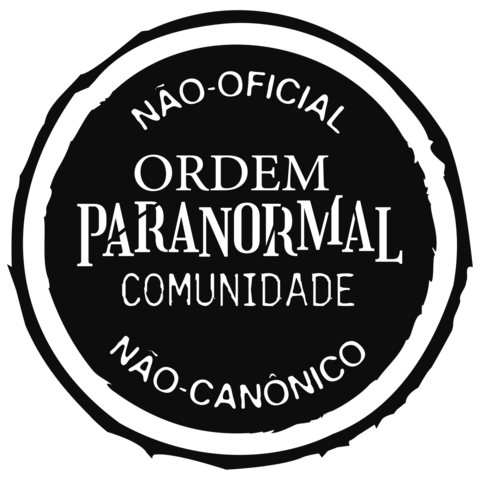
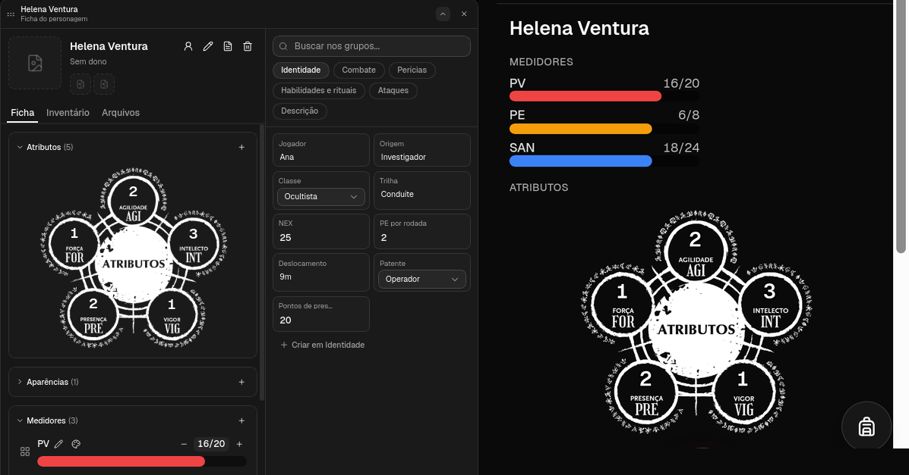
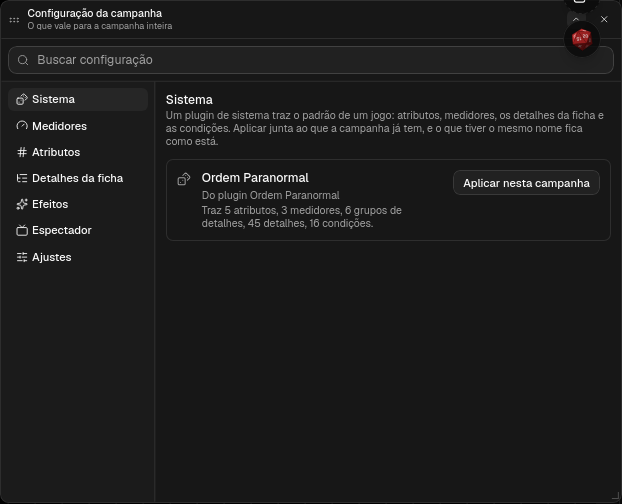
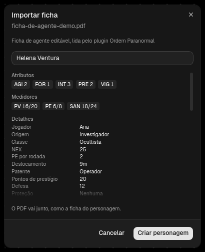

# Ordem Paranormal para o ATO20



**Este é um conteúdo não oficial, publicado sob a Licença da Comunidade de
Ordem Paranormal.** Ordem Paranormal é do Rafael "Cellbit" Lange, e o livro de
regras é da Jambô Editora. O plugin é de fã, gratuito, e não tem parceria nem
aprovação de nenhum dos dois. Ver [Licença e fontes](#licença-e-fontes).

Plugin que põe Ordem Paranormal no ATO20. Não tem código: é o `manifest.json`,
a imagem do ritual e os arquivos do bestiário e dos itens.

- **O sistema:** ao criar a campanha (ou depois, em Configuração da campanha,
  Sistema), ela nasce com AGI, FOR, INT, PRE e VIG, os medidores PV, PE e SAN,
  a ficha de agente nos detalhes (Identidade, Combate, as 28 perícias,
  Habilidades e rituais, Ataques e Descrição) e 16 condições do jogo.
- **O ritual:** os atributos aparecem na ficha dentro do ritual, cada número
  no círculo dele, na ficha do mestre e no celular de quem joga.
- **A ficha em PDF:** na lista de Personagens, **Importar ficha em PDF** cria
  o personagem a partir da ficha de agente editável, com o PDF anexado como a
  ficha dele. Com o sistema aplicado, tudo cai nos detalhes do molde.
- **O bestiário:** as 68 ameaças oficiais no Compêndio, uma pasta por elemento.
- **Os itens:** armas, munição, granadas, proteção e cura no Compêndio, prontos
  para pôr em jogo.



## O sistema



| | Começa com |
| --- | --- |
| Atributos | AGI, FOR, INT, PRE e VIG, em 1 |
| Medidores | PV 20, PE 2 e SAN 12 (a base de Combatente) |
| Identidade | jogador, origem, classe (Combatente, Especialista, Ocultista), trilha, NEX 5, PE por rodada 1, deslocamento 9m, patente (Recruta a Agente de elite), pontos de prestígio |
| Combate | defesa 10, proteção, resistências, DT de rituais |
| Perícias | as 28, em 0 |
| Listas | Habilidades e rituais, Ataques, e Descrição (aparência, personalidade, histórico, objetivo) |
| Condições | Machucado, Morrendo, Sangrando, Perturbado, Enlouquecendo, Abalado, Apavorado, Atordoado, Desprevenido, Agarrado, Caído, Fatigado, Envenenado, Cego, Paralisado e Inconsciente |

Aplicar junta ao que a campanha já tem: o que tiver o mesmo nome fica como o
mestre deixou.

## O ritual

Com o sistema aplicado, a ficha desenha AGI, FOR, INT, PRE e VIG no ritual, e
não nos cartões. O mestre clica no número para mudar; o botão direito no
círculo troca a sigla, escreve a descrição ou apaga o atributo. Um atributo
que não está no ritual (SOR, por exemplo) fica num cartão logo abaixo.

Numa campanha que já existia, aplique o sistema de novo (Configuração da
campanha, Sistema): o que ela já tem fica como está, e o ritual entra.

## A ficha

O plugin lê a ficha de agente **editável** feita no PDFescape, a que tem os
campos `untitled1` a `untitled340`. A impressa, a digitalizada e a que não tem
formulário continuam entrando como anexo.

O PDF da ficha não vem no plugin: ela é da Jambô Editora.



## O que vira o quê

| Na ficha | No personagem |
| --- | --- |
| Personagem | o nome |
| AGI, FOR, INT, PRE, VIG | atributos |
| PV, PE e SAN, atuais e máximos | medidores PV, PE e SAN |
| Jogador, origem, classe, NEX, PE por rodada, deslocamento, patente, prestígio | detalhes em Identidade |
| Defesa, proteção, resistências, DT de rituais | detalhes em Combate |
| As 28 perícias, pelo bônus | detalhes em Perícias |
| Aparência, personalidade, histórico, objetivo | detalhes em Descrição, cada um com as cinco linhas juntas |
| Ataques (teste, dano, crítico/alcance) | uma linha por ataque em Ataques |
| Habilidades & rituais (custo, descritivo) | uma linha por habilidade em Habilidades e rituais |

O inventário fica de fora por enquanto: ele segue no PDF anexado.

## Os itens

Na aba Itens do Compêndio, quatro pastas: **Armas**, **Munição**,
**Explosivos** e **Proteção e cura**. Clicar num item mostra tudo dele; **Pôr
em jogo** o põe no catálogo de Itens da campanha, e **Trazer para a campanha**
o deixa no Compêndio dela para editar.

| Pasta | Itens |
| --- | --- |
| Armas | faca, faca tática, facão, machadinha, revólver .38, pistola 9mm, pistola .40, submetralhadora 9mm, escopeta calibre 12, fuzil de caça, fuzil 7,62 (FAL), fuzil 5,56 (IA2) e fuzil de precisão 7,62 |
| Munição | munição 9mm (balas curtas), munição de fuzil (balas longas) e cartuchos calibre 12 |
| Explosivos | granadas de fragmentação, incendiária, de atordoamento e de fumaça |
| Proteção e cura | bandagem, cicatrizante, colete balístico, proteção pesada e escudo balístico |

Os números são os do livro: dano, crítico, alcance, categoria e espaços. As
armas têm nome de arma que existe no Brasil, e quando o nome não é o do livro o
atributo **Base** diz qual arma do livro ela é (a pistola .40 é a pistola
pesada, a escopeta é a espingarda). A munição tem o medidor **Cenas**: quantas
cenas o pacote ainda dura em cada mochila. Os itens vêm sem imagem por
enquanto, e por isso entram em jogo pelo botão, e não arrastando para o mapa.

## Instalar

No ATO20: Configurações → Plugins → **Catálogo**, e **Instalar** no Ordem
Paranormal. Quando sair versão nova, o mesmo botão vira **Atualizar**.

Pede o ATO20 com a API de plugins 13.

Num ATO20 sem o catálogo:

1. Clone o repositório (ou baixe o zip dele):

   ```
   git clone https://github.com/ato20-org/ato20.ordem-paranormal.plugin
   ```

2. No ATO20, Configurações, Plugins, **Importar plugin**, e escolha a pasta.

Funciona ao lado do Segredo na Floresta: o medidor que a campanha já tem com
o mesmo nome (PV, PE, SAN) continua com o estilo que o mestre escolheu, as
barras de pincel por exemplo, e a ficha só diz quanto.

## Licença e fontes

Publicado sob a [Licença da Comunidade de Ordem Paranormal](https://ordemparanormal.com.br/licenca),
com o [selo dela](https://ordemparanormal.com.br/selo-licenca-ordem) no topo
desta página. Universo, nomes, personagens e criaturas são do Cellbit; o livro
de regras é da Jambô Editora. Para jogar, [compre o livro](https://jamboeditora.com.br).

De onde vem o que o plugin traz:

- **O livro de regras** (Jambô, 2022): os atributos, as perícias, as condições,
  os campos da ficha de agente e os números dos itens.
- **Sobrevivendo ao Horror** e **Arquivos Secretos** (Jambô): a faca tática e a
  pistola pesada, do primeiro, e a bandagem, do segundo. Os nomes brasileiros
  das armas são do plugin.
- **[C.R.I.S. - Ordem Paranormal](https://crisordemparanormal.com)** e
  **[Ordem Paranormal Wiki](https://ordemparanormal.fandom.com/pt-br)**: as
  ameaças do bestiário, que chega na próxima versão. O texto do wiki é
  [CC BY-SA](https://www.fandom.com/pt-br/licensing-pt-br), e o que vier dele
  segue nessa licença, com o crédito ao wiki.

Se você tem direito sobre algo que está aqui e quer que saia, abra uma
[issue](https://github.com/ato20-org/ato20.ordem-paranormal.plugin/issues):
sai sem discussão.
